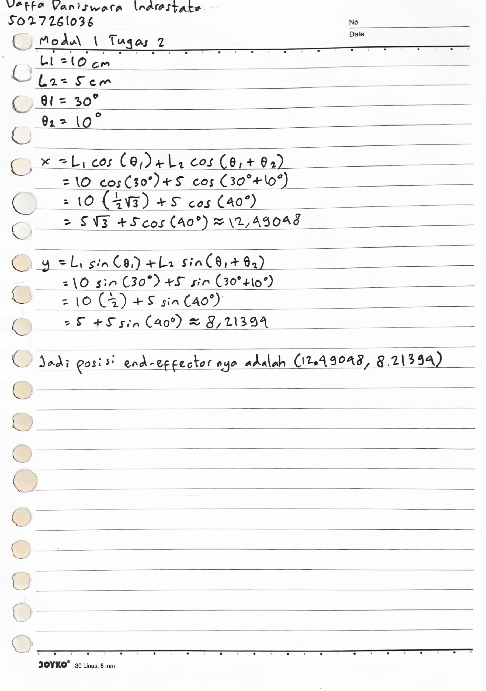

# Tugas Modul 1 Internship Programming RIVAL

## Daftar Isi

- [Tugas 1](#tugas-1)
  - [Class Player](#class-player)
  - [Class Board](#class-board)
  - [How To Play](#how-to-play)
- [Tugas 2](#tugas-2)
- [Tugas 3](#tugas-3)

## Tugas 1

Pada tugas 1, saya membuat program permainan Tic-Tac-Toe dengan menggunakan beberapa class.

### Class Player

Class yang digunakan untuk menyimpan data dari setiap pemain.

```cpp
private:
    char symbol;
    string name;
```

Atribut di atas digunakan untuk menyimpan nama dan simbol pemain (X/O). Atribut dienkapsulasi karena hanya berfungsi untuk dibaca saja.

```cpp
char getSymbol() const {
    return symbol;
}

string getName() const {
    return name;
}
```
Getter method untuk mengambil nilai atribut.

### Class Board

Class yang digunakan untuk menyimpan board yang sedang dimainkan.

```cpp
private:
    char board[9];

public:
    Board() {
        for(char &c : board) c = ' ';
    }
```

Board dibuat dengan menggunakan array char yang berukuran 9 (3x3) dan diisi dengan spasi.

```cpp
void print() {}
bool makeMove(int r, int c, Player &player) {}
bool isWinner(Player &player) {}
bool isFull() {}
```

Method print digunakan untuk mencetak board. makeMove digunakan untuk menyimpan langkah pemain pada board sekaligus mengonfirmasi apakah langkah tersebut valid atau tidak. isWinner untuk mengecek apakah pemain memenangkan permainan dan isFull untuk mengecek apakah board sudah penuh atau belum.

### How To Play

1. Input nama pemain

```
Siapa namamu (Player 1)? 
Siapa namamu (Player 2)? 
```

2. Input langkah dengan format: baris(1-3) kolom(1-3). Contoh: 1 2

```
  |   |  
--+---+--
  |   |  
--+---+--
  |   |  
Sekarang adalah giliran {Nama Player 1} (X). Masukkan langkahmu, baris(1-3) kolom(1-3): 
```

3. Main sampai ada yang menang atau board sudah penuh (seri)
4. Ulang jika ingin main lagi

## Tugas 2



## Tugas 3

```cpp
#include <iostream>
#include <cmath>
```

Masukkan header iostream (untuk I/O) dan cmath (untuk fungsi dan konstan matematika).

```cpp
#define L1 10
#define L2 5
#define THETA1 30
#define THETA2 10
```

Definisikan parameter pada soal dengan macro.

```cpp
radTheta1 = THETA1 * (M_PI / 180);
radTheta2 = THETA2 * (M_PI / 180);
```

Konversi theta dari derajat ke radian.

```cpp
x = L1 * cos(radTheta1) + L2 * cos(radTheta1 + radTheta2);
y = L1 * sin(radTheta1) + L2 * sin(radTheta1 + radTheta2);
```

Hitung posisi end-effector dengan rumus seperti pada modul.